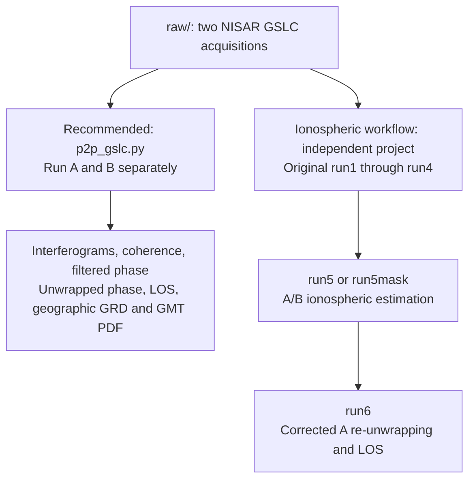
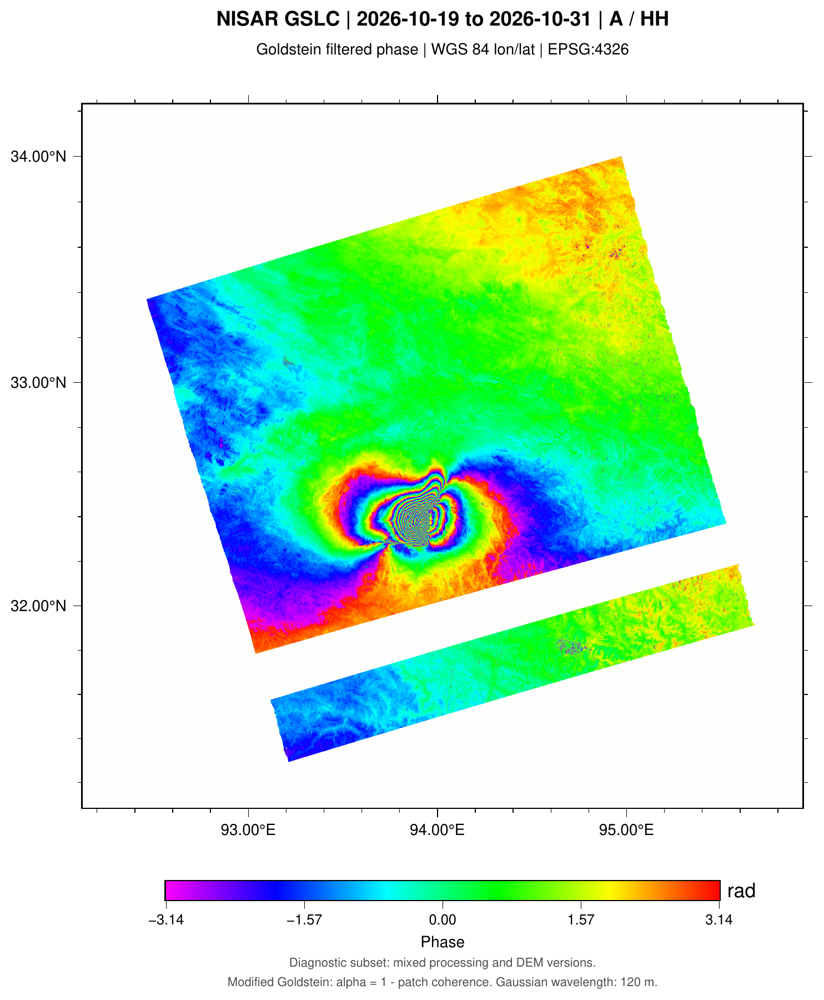
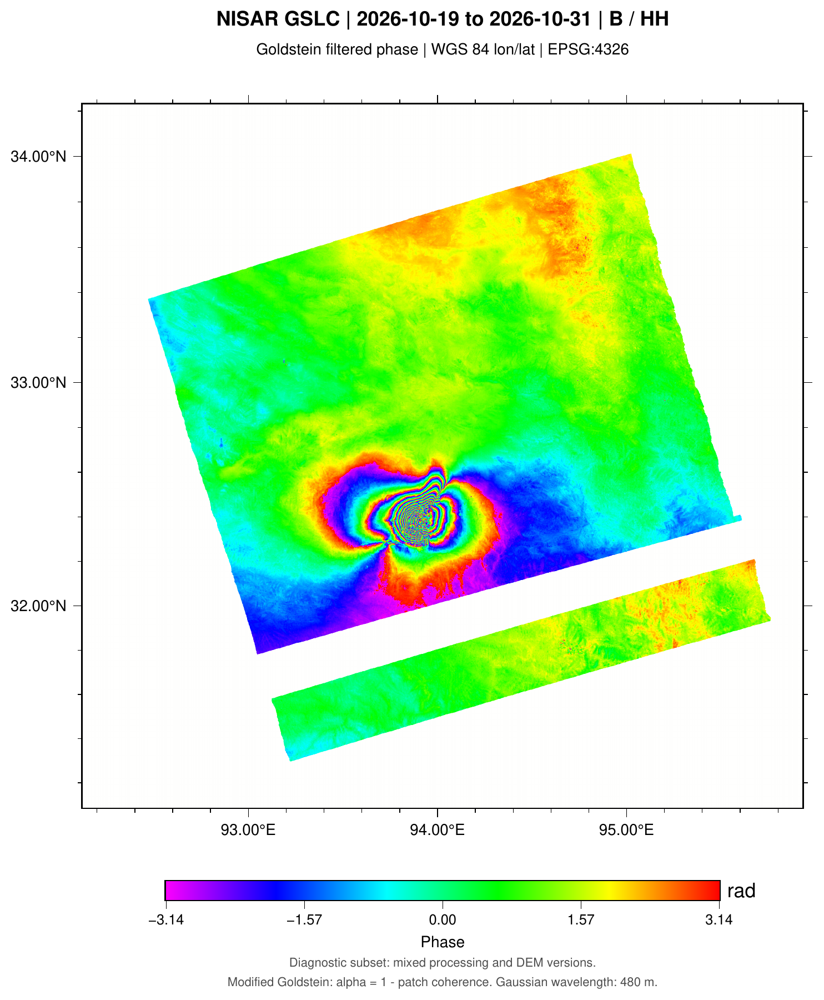
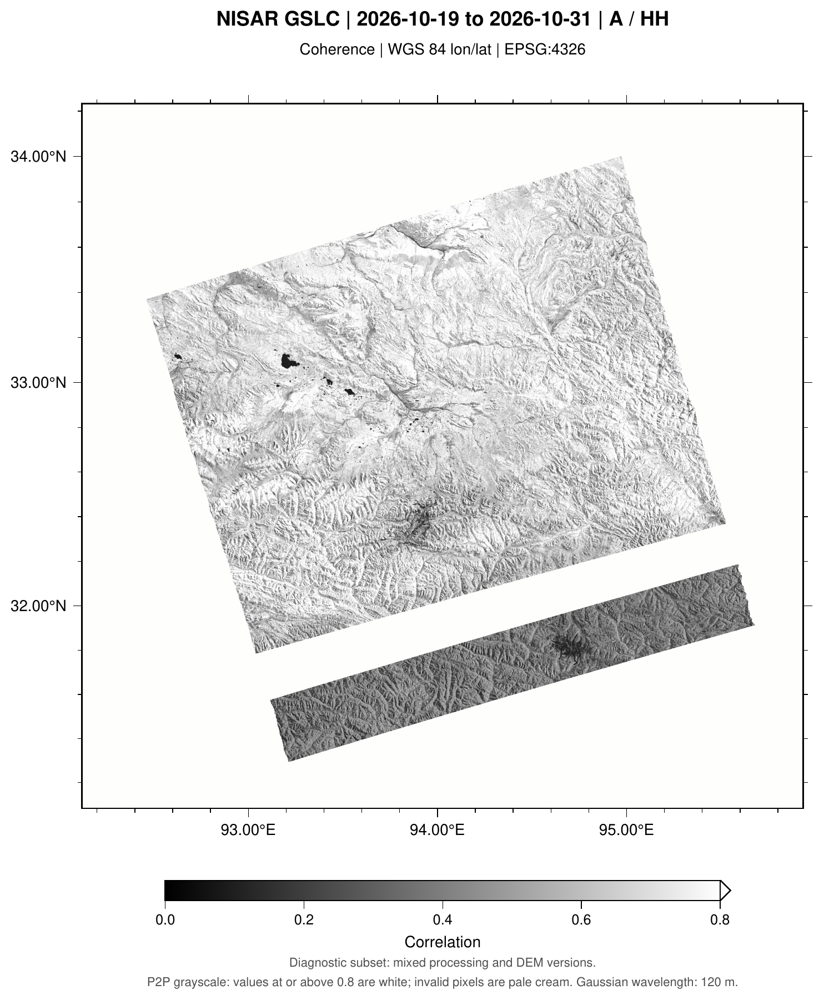
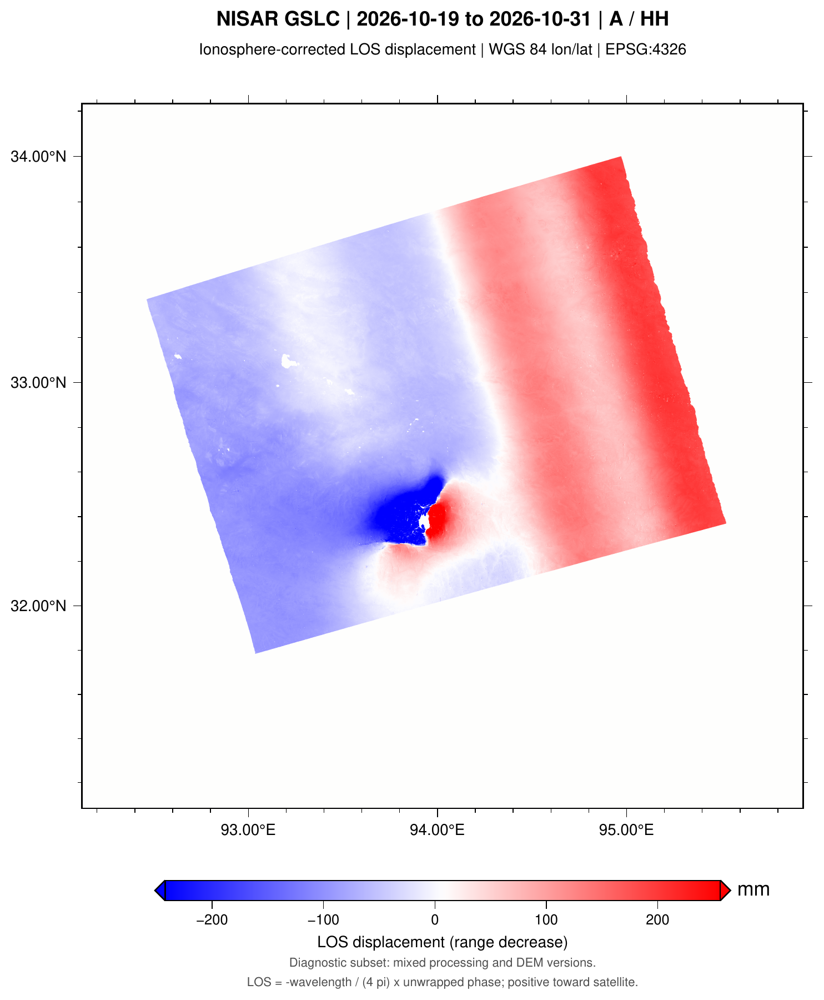
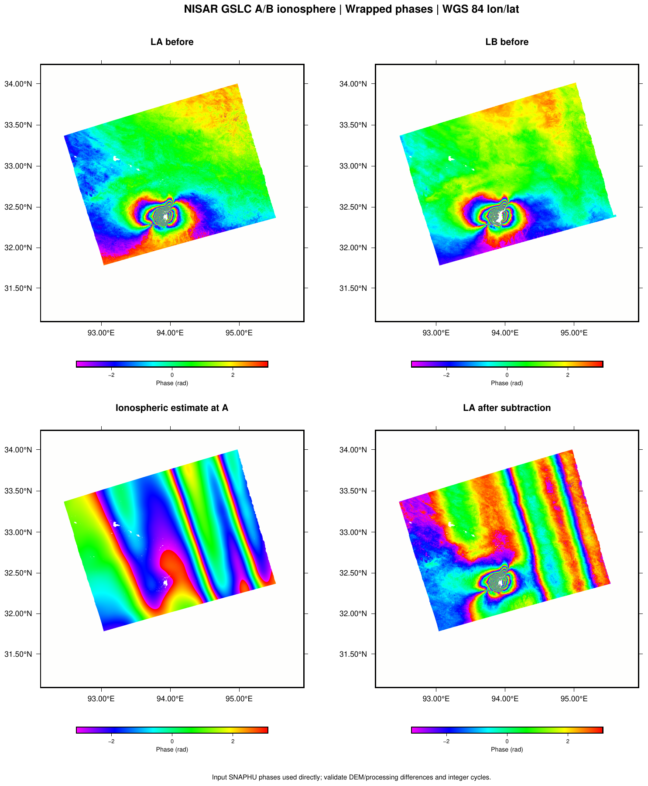

# NISAR GSLC DInSAR and Ionospheric Correction

**English** | [简体中文](README.zh-CN.md)

**Author:** Xin Wang, USTC · **Contact:** [xinw11@mail.ustc.edu.cn](mailto:xinw11@mail.ustc.edu.cn)

Use **[p2p_gslc.py](p2p_gslc.py)** as the recommended GMTSAR-style entry point
for NISAR GSLC pair processing. One command per frequency produces
interferograms, coherence, Goldstein-filtered phase, SNAPHU unwrapping, LOS,
longitude/latitude grids and GMT figures.

For **ionospheric estimation and corrected A re-unwrapping**, use the original
[run1–run6 workflow](#ionospheric-correction-original-workflow), retained in this
repository as version 0.6.5. The compact entry point handles pair processing;
the original workflow handles the complete ionospheric sequence.

## Installation

Install or activate an existing SAR environment containing:

| Software | Requirement |
| --- | --- |
| Python | 3.9 or newer |
| Python packages | NumPy, SciPy, h5py, netCDF4, pyproj, rasterio; see [requirements.txt](requirements.txt) |
| GMTSAR | An installed, compiled `phasefilt` executable |
| SNAPHU | 2.x, for phase unwrapping |
| GMT | 6, for figures |
| Ghostscript | `gs`, for PDF output |
| Csh | Required for the original numbered `.csh` workflow |
| Poppler | Optional `pdftoppm` for PNG previews |

From the repository root, using the Python environment intended for processing:

```bash
python -m pip install -r requirements.txt
python -c 'import numpy,scipy,h5py,netCDF4,pyproj,rasterio; print("Python dependencies OK")'
command -v phasefilt snaphu gmt gs
```

Install GMTSAR, SNAPHU, GMT and Ghostscript separately if missing, and add their
executable directories to `PATH`; `pip` installs the Python packages. An
existing working GMTSAR installation can be reused.

## Recommended: p2p_gslc.py

The compact entry consists of three files:

- [p2p_gslc.py](p2p_gslc.py)
- [config_NSR_GSLC_A.txt](config_NSR_GSLC_A.txt)
- [config_NSR_GSLC_B.txt](config_NSR_GSLC_B.txt)

Put the two NISAR GSLC `.h5` acquisitions, or symbolic links, in `raw/`.
Each acquisition contains the A/B frequency data. Flattened GSLC inputs need
no separate orbit or DEM files. The processor reads HDF5 inputs without modifying them.

```text
python p2p_gslc.py NSR_A|NSR_B master_image aligned_image [configuration_file]
```

Run `python p2p_gslc.py` or `python p2p_gslc.py --help` to display usage and a
complete example using the development pair's filenames.

For A/B processing, run each frequency in a separate working directory. From
the repository root, replace `MASTER.h5` and `SECONDARY.h5` below with the actual
filenames in `raw/`. The first acquisition is the reference when `switch_master = 0`.

```bash
mkdir -p raw LA LB
# Put the two GSLC .h5 acquisitions in raw/ before processing.

cd LA
python ../p2p_gslc.py NSR_A ../raw/MASTER.h5 ../raw/SECONDARY.h5 ../config_NSR_GSLC_A.txt

cd ../LB
python ../p2p_gslc.py NSR_B ../raw/MASTER.h5 ../raw/SECONDARY.h5 ../config_NSR_GSLC_B.txt
cd ..
```

Input names may include `.h5` or use stems when the files are in the current
working directory or its `raw/`. Explicit file paths are also supported.
If the configuration argument is omitted, the processor reads the corresponding
`config_NSR_GSLC_A.txt` or `config_NSR_GSLC_B.txt` in the current working directory;
if absent, it creates the annotated default configuration and continues processing.
Existing configurations and completed pair outputs are protected.

## Pair configuration and outputs

The compact configurations use the familiar GMTSAR `parameter = value` format,
with English comments and processing-stage sections.

| Parameter | A / HH | B / HH |
| --- | --- | --- |
| Output spacing, east x north | **40 x 40 m** | **120 x 120 m** |
| Gaussian wavelength | **160 m** | **640 m** |
| Goldstein mode | Coherence-adaptive | Coherence-adaptive |
| Goldstein patch | 32 x 32 output pixels | 32 x 32 output pixels |
| Unwrapping coherence threshold | 0.1 | 0.1 |
| SNAPHU tiles | Automatic | Automatic |
| SNAPHU tile workers | 2 | 2 |

`gslc_spacing_x/y` explicitly fix output spacing, independently of the Gaussian
wavelength and `dec_factor`. Clearing both enables automatic map-grid sampling.
`gslc_region` is `XMIN/XMAX/YMIN/YMAX` in product-CRS metres; blank processes
the full common extent. Effective spatial resolution also depends on the
input bandwidth and filtering.

`proc_stage = 1` runs the complete pair sequence. Stages 1–3 validate inputs,
4 forms and filters the interferogram, 5 unwraps, and 6 exports longitude/latitude.
For interrupted processing, use stage 5 or 6 only when the preceding pair
products are complete and compatible. Move old unwrap/LOS or `lonlat/` outputs
before explicitly repeating those stages.

Results are written to `intf/YYYYDDD_YYYYDDD/` in each working directory:

```text
LA/intf/<pair>/
LB/intf/<pair>/
    phase.grd, corr.grd, phasefilt.grd
    unwrap.grd, conncomp.grd, los.grd
    display_amp.grd
    p2p_gslc.json            # Input and configuration provenance
    *.pdf                   # Native-coordinate GMT figures
    lonlat/*_ll.grd          # WGS 84 longitude/latitude grids
    lonlat/*_ll.pdf          # Geographic GMT figures
```

GRD is the primary format. Phase is in radians. LOS is computed directly as
`-wavelength / (4*pi) * unwrapped_phase`, positive toward the satellite, with
no reference offset subtraction. LOS grids use metres and figures millimetres.
Figures have unshaded colors and bottom colorbars.

## Ionospheric correction: original workflow

Use the retained run1–run6 workflow when ionospheric estimation, polygon masking
or corrected A re-unwrapping is needed. It has its own project metadata
(`gslc_project.json` and `run.json`); compact pair processing writes
`p2p_gslc.json`. Prepare an independent original-workflow project for this path.
A compact pair directory is not a direct continuation input to `run5`.

From the repository root, choose a new project directory and put or link the
two acquisitions into that project's `raw/`:

```bash
export NISAR_GSLC_PYTHON="$(command -v python)"
gslc_iono_project="/path/to/iono_project"
mkdir -p "$gslc_iono_project/raw"
# Put the two GSLC .h5 files, or links to them, in this raw/ directory.

nohup ./run1-6_gslc_all.csh --project "$gslc_iono_project" > run1-6_gslc_all.log 2>&1 &
tail -f run1-6_gslc_all.log
```

The controller waits for each stage and stops on failure. Stage logs are saved
under the project's `logs/`; the ordinary final A output is `LA_iono_corrected/`.

| Stage | Work |
| --- | --- |
| run1 | Inspect the pair; prepare LA/LB and configurations |
| run2 | Interferograms, Gaussian weighting, decimation, coherence and Goldstein |
| run3 | Optional pre-SNAPHU mask preview |
| run4 | Unwrap A/B; convert to LOS; export longitude/latitude |
| run5 | Estimate and filter ionosphere from A/B unwrapped phases |
| run6 | Re-unwrap corrected A; export phase, LOS and longitude/latitude |

For polygon masking, retain the existing `run5mask_iono_GSLC_LA_LB.csh`
mode 1 preview and mode 2 estimation, followed by run6. Instructions are in the
[workflow guide](WORKFLOW_GSLC.md) and [server guide](SERVER_RUN.md).

The original workflow keeps its configurations under `configs/`, prepares
`LA/config_GSLC_A.txt`, `LB/config_GSLC_B.txt` and `config_IONO.txt`, and retains
its earlier Gaussian defaults A=120/B=480 m. These are separate from the compact
`config_NSR_GSLC_A/B.txt` files. Its ionospheric filter wavelength is 20,000 m,
with 1,000 m A prefiltering on the B grid.

The numbered shell wrappers remain optional within the original workflow:

```bash
python gslc_workflow.py prepare --project "$gslc_iono_project"
# Review the generated A/B and ionospheric configurations before processing.
python gslc_workflow.py process --project "$gslc_iono_project"
python gslc_workflow.py preview --project "$gslc_iono_project"
python gslc_workflow.py unwrap --project "$gslc_iono_project"
python gslc_workflow.py iono --project "$gslc_iono_project"
python gslc_workflow.py correct --project "$gslc_iono_project"
```

Choose either the all-stage controller or the individual calls for a project.
The controller additionally handles stage order, per-stage logs and stopping on failure.

## Workflow overview



## Example products

The following examples come from the original workflow's **2026-10-19 to
2026-10-31** A/B HH pair in WGS 84 longitude/latitude. Click to view full size.

| A: Goldstein-filtered phase | B: Goldstein-filtered phase |
| --- | --- |
| [](docs/images/a_phase.png) | [](docs/images/b_phase.png) |

| A coherence | Corrected A LOS after re-unwrapping |
| --- | --- |
| [](docs/images/a_coherence.png) | [](docs/images/a_corrected_los.png) |

The masked branch excludes the detached southern strip. The four panels show
A/B input phases, the A-frequency ionospheric estimate, and A after subtraction.

[](docs/images/ionosphere_comparison.png)

## Validation and interpretation

The compact processor was checked on a 40.96 x 20.48 km HH subset of the same
pair, using A=40 x 40 m and B=120 x 120 m with Gaussian wavelengths 120/480 m.
Checks covered agreement with the original interferometry/filtering engine,
unwrapping, LOS, geographic exports and GMT PDFs. Full-scene runtime was not
measured by that subset check.

Inputs must have compatible geometry, frequencies, projected grids and
flattening metadata. Map-coordinate matching does not perform precision
subpixel coregistration. Mixed processing or flattening-DEM versions,
unwrapping cycle errors and disconnected-region offsets require evaluation
before quantitative displacement or ionospheric interpretation. Tiled
connected-component labels remain tile-local. The example figures illustrate
processing outputs and do not establish scientific accuracy.

## Documentation and credits

- [Workflow and parameters](WORKFLOW_GSLC.md) · [中文流程说明](WORKFLOW_GSLC.zh-CN.md)
- [Server use and recovery](SERVER_RUN.md) · [中文服务器说明](SERVER_RUN.zh-CN.md)
- [Authors and acknowledgments](AUTHORS.md)
- [Provenance](UPSTREAM_PROVENANCE.md) · [GNU GPL v3](LICENSE)

The original workflow uses `gslc_workflow.py`, `make_intf_nsr_gslc.py`,
`iono_gslc.py`, `plot_gslc_gmt.py` and `reproject_gslc.py`. The compact
`p2p_gslc.py` does not import those local modules. The GSLC adaptation follows
Xin Wang's earlier [RSLC workflow](https://github.com/Xin-Wang-520/gmtsar-nisar-dinsar-workflow).
