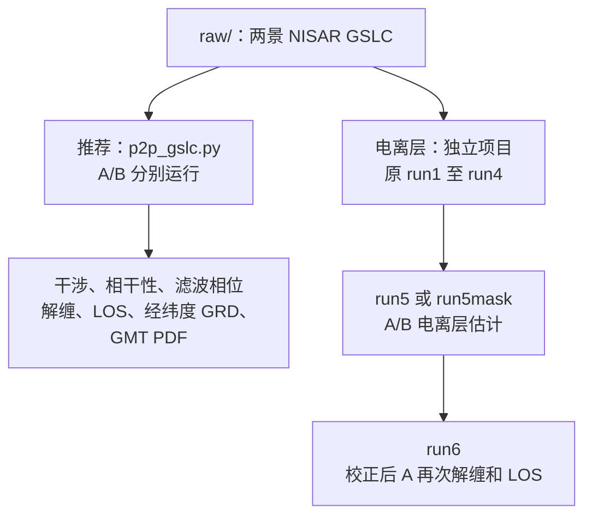
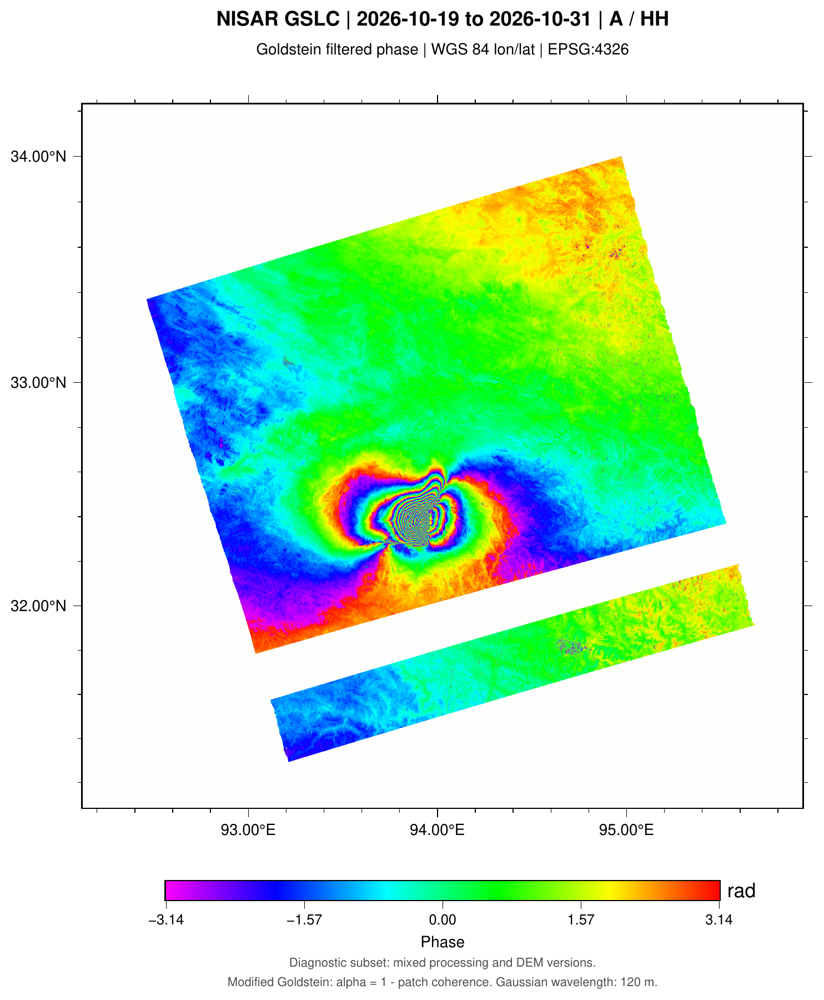
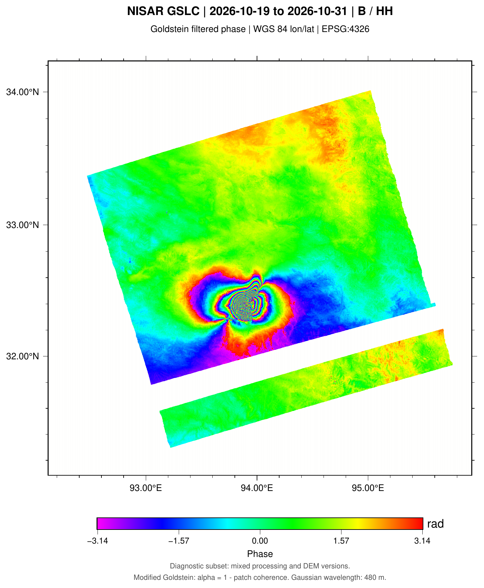
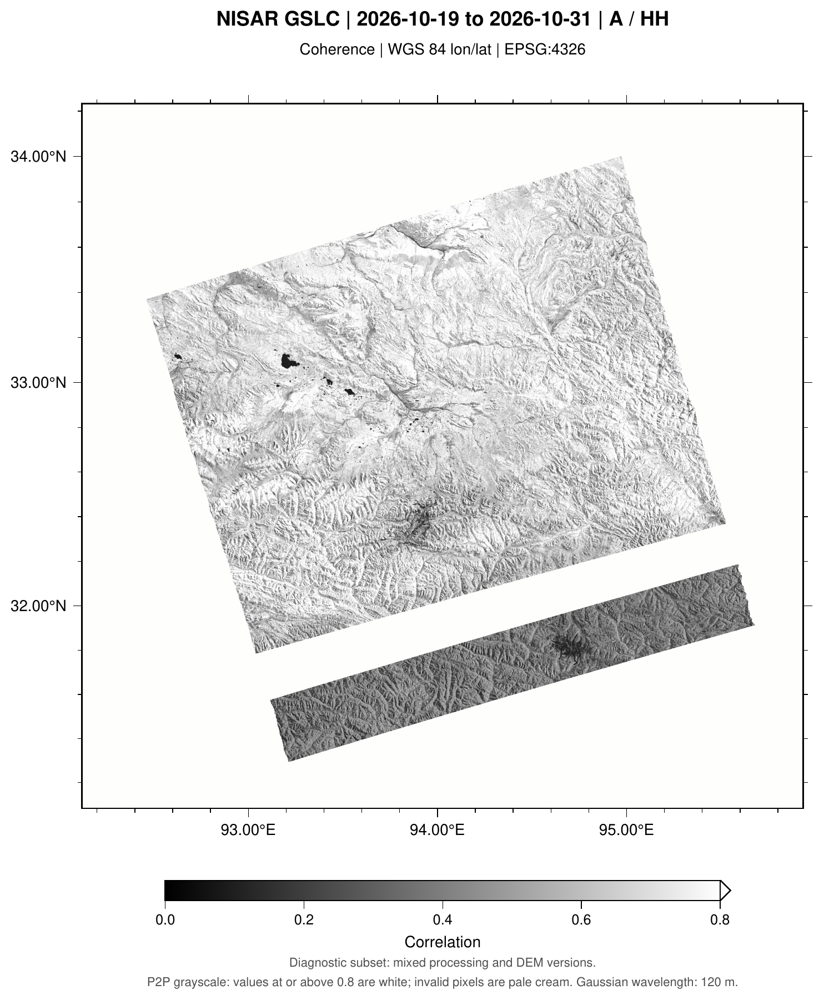
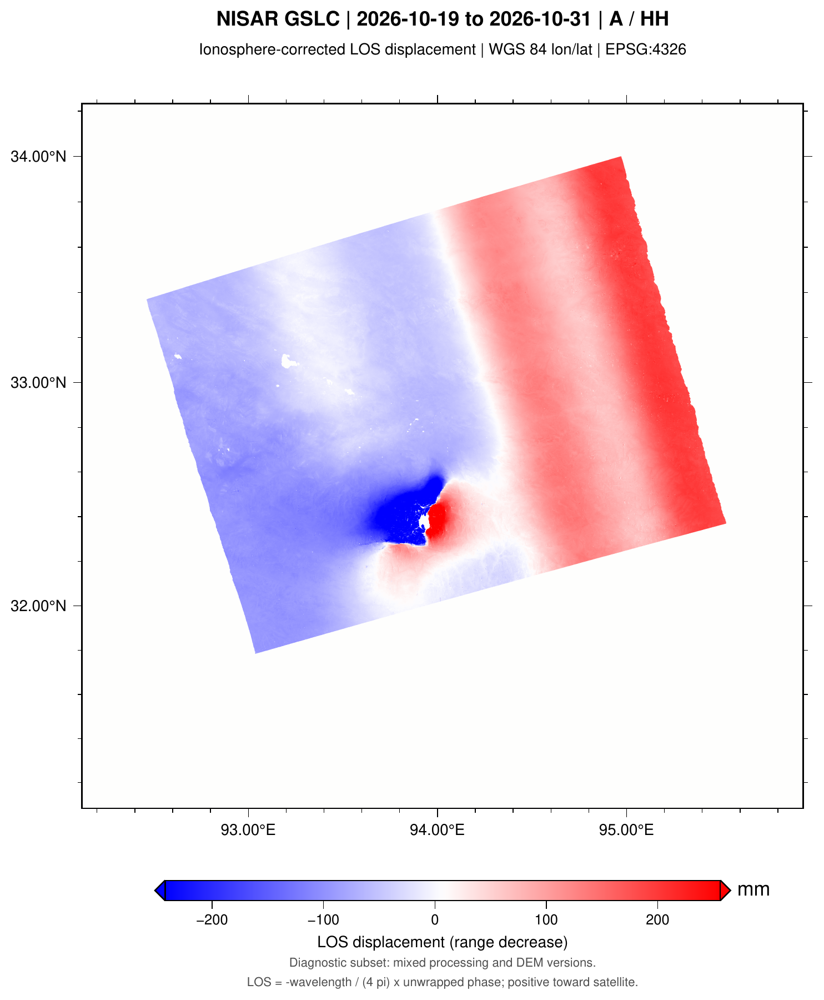
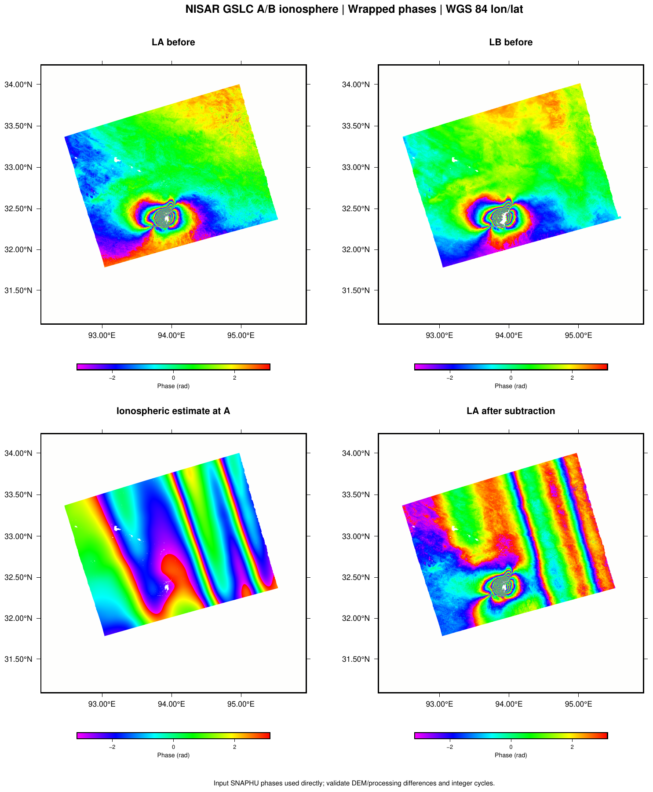

# NISAR GSLC 差分干涉与电离层校正

[English](README.md) | **简体中文**

**作者：** Xin Wang，USTC · **邮箱：** [xinw11@mail.ustc.edu.cn](mailto:xinw11@mail.ustc.edu.cn)

常规 GSLC 配对处理优先使用 **[p2p_gslc.py](p2p_gslc.py)**，调用方式与 GMTSAR
的 p2p 习惯相同。每个频段一条命令，完成干涉、相干性、Goldstein 滤波、SNAPHU 解缠、
LOS、经纬度 GRD 和 GMT 出图。

需要**电离层估计和校正后 A 再次解缠**时，继续使用本仓库保留的
[原 run1–run6 流程](#电离层校正原有流程)（0.6.5）。精简入口负责配对处理，
原流程负责完整电离层处理。

## 安装依赖

安装或激活已有的 SAR 环境，需要：

| 软件 | 要求 |
| --- | --- |
| Python | 3.9 及以上 |
| Python 包 | NumPy、SciPy、h5py、netCDF4、pyproj、rasterio，见 [requirements.txt](requirements.txt) |
| GMTSAR | 已安装、编译好的 `phasefilt` 程序 |
| SNAPHU | 2.x，用于解缠 |
| GMT | 6，用于绘图 |
| Ghostscript | `gs`，用于 PDF 输出 |
| Csh | 原来的编号 `.csh` 流程需要 |
| Poppler | 可选的 `pdftoppm`，用于 PNG 预览 |

进入仓库根目录，在实际处理使用的 Python 环境中执行：

```bash
python -m pip install -r requirements.txt
python -c 'import numpy,scipy,h5py,netCDF4,pyproj,rasterio; print("Python dependencies OK")'
command -v phasefilt snaphu gmt gs
```

缺少 GMTSAR、SNAPHU、GMT 或 Ghostscript 时，需要另行安装，并将可执行程序目录加入
`PATH`；`pip` 安装的是 Python 依赖。已经能正常使用的 GMTSAR 环境可以继续使用。

## 推荐方式：p2p_gslc.py

精简入口由三个文件组成：

- [p2p_gslc.py](p2p_gslc.py)
- [config_NSR_GSLC_A.txt](config_NSR_GSLC_A.txt)
- [config_NSR_GSLC_B.txt](config_NSR_GSLC_B.txt)

在 `raw/` 放两景 NISAR GSLC `.h5`，也支持软链接；每景包含 A/B 频率数据。
已展平的 GSLC 输入不需要另备轨道或 DEM，程序只读原始 HDF5。

```text
python p2p_gslc.py NSR_A|NSR_B master_image aligned_image [configuration_file]
```

输入 `python p2p_gslc.py` 或 `python p2p_gslc.py --help`，可以查看用法和使用开发数据对
完整文件名的示例命令。

A/B 分别在独立工作目录中运行。从仓库根目录开始，将下面的 `MASTER.h5` 和
`SECONDARY.h5` 换成 `raw/` 中的实际文件名。`switch_master = 0` 时，第一景为参考景。

```bash
mkdir -p raw LA LB
# 运行前，将两景 GSLC .h5 放进 raw/。

cd LA
python ../p2p_gslc.py NSR_A ../raw/MASTER.h5 ../raw/SECONDARY.h5 ../config_NSR_GSLC_A.txt

cd ../LB
python ../p2p_gslc.py NSR_B ../raw/MASTER.h5 ../raw/SECONDARY.h5 ../config_NSR_GSLC_B.txt
cd ..
```

输入可用 `.h5` 文件名或文件主名，程序在当前工作目录及其 `raw/` 中查找；也支持明确的文件路径。
省略配置参数时，读取当前工作目录的 `config_NSR_GSLC_A.txt` 或 `config_NSR_GSLC_B.txt`；
不存在时，自动生成带英文注释的默认配置，然后继续处理。已有配置和已完成的配对输出受保护。

## 配对配置与输出

精简配置采用 GMTSAR 常见的 `参数名 = 数值`，按处理阶段分块，带英文说明。

| 参数 | A / HH | B / HH |
| --- | --- | --- |
| 输出网格间距，东西 × 南北 | **40×40 m** | **120×120 m** |
| 高斯滤波波长 | **160 m** | **640 m** |
| Goldstein 模式 | 相干性自适应 | 相干性自适应 |
| Goldstein 窗口 | 32×32 输出像元 | 32×32 输出像元 |
| 解缠相干性阈值 | 0.1 | 0.1 |
| SNAPHU 分块 | 自动 | 自动 |
| SNAPHU 分块工作进程数 | 2 | 2 |

`gslc_spacing_x/y` 已明确固定输出间距，高斯波长和 `dec_factor` 不再改变该间距。
将两个间距都留空，才启用自动地图采样。`gslc_region` 的顺序为
`XMIN/XMAX/YMIN/YMAX`，使用产品投影坐标的米；留空处理整幅共同覆盖范围。
有效空间分辨率还取决于原始带宽和滤波。

`proc_stage = 1` 执行完整配对处理；阶段 1–3 检查输入，4 做干涉和滤波，5 解缠，6 转经纬度。
中断后，仅在前序配对产品完整且兼容时用阶段 5 或 6 继续。
明确重做时，先移动旧解缠/LOS 或 `lonlat/` 输出。

每个工作目录的结果保存在 `intf/YYYYDDD_YYYYDDD/`：

```text
LA/intf/<pair>/
LB/intf/<pair>/
    phase.grd, corr.grd, phasefilt.grd
    unwrap.grd, conncomp.grd, los.grd
    display_amp.grd
    p2p_gslc.json            # 输入和配置信息
    *.pdf                   # 原生坐标 GMT 图
    lonlat/*_ll.grd          # WGS 84 经纬度网格
    lonlat/*_ll.pdf          # 经纬度 GMT 图
```

GRD 为主要格式，相位单位为 radian。LOS 直接按
`-波长 / (4*pi) × 解缠相位` 换算，朝卫星为正，不减参考常数；网格单位 m，图上 mm。
图不加梯度阴影，色标放在下方。

## 电离层校正：原有流程

需要电离层估计、多边形 mask 或校正后 A 再次解缠时，继续使用原 run1–run6 流程。
它需要自身的 `gslc_project.json` 和 `run.json`，精简配对程序记录的是 `p2p_gslc.json`。
因此，应单独准备原流程项目；精简配对目录不能直接作为 run5 的续跑输入。

从仓库根目录开始，选择一个新项目目录，把两景数据放入或链接到该项目的 `raw/`：

```bash
export NISAR_GSLC_PYTHON="$(command -v python)"
gslc_iono_project="/path/to/iono_project"
mkdir -p "$gslc_iono_project/raw"
# 将两景 GSLC .h5 或指向它们的软链接放入这个 raw/。

nohup ./run1-6_gslc_all.csh --project "$gslc_iono_project" > run1-6_gslc_all.log 2>&1 &
tail -f run1-6_gslc_all.log
```

总控逐步等待，前一步成功才进入下一步，失败停止。分步日志在项目的 `logs/` 中，
普通流程最终 A 结果位于 `LA_iono_corrected/`。

| 步骤 | 工作 |
| --- | --- |
| run1 | 检查两景，准备 LA/LB 和配置 |
| run2 | 干涉、高斯加权、降采样、相干性和 Goldstein |
| run3 | 可选的解缠前质量掩膜预览 |
| run4 | A/B 解缠、转 LOS、导出经纬度 |
| run5 | 利用 A/B 解缠相位估计并滤波电离层 |
| run6 | 校正后 A 再次解缠，输出相位、LOS 和经纬度 |

多边形掩膜继续使用 `run5mask_iono_GSLC_LA_LB.csh` 的模式 1 预览、模式 2 估计，
然后运行 run6，详见[流程说明](WORKFLOW_GSLC.zh-CN.md)和[服务器说明](SERVER_RUN.zh-CN.md)。

原流程保留 `configs/` 中的配置，准备后使用 `LA/config_GSLC_A.txt`、
`LB/config_GSLC_B.txt`、`config_IONO.txt`，高斯默认仍为 A=120/B=480 m，
与精简入口的 `config_NSR_GSLC_A/B.txt` 分别使用。
电离层滤波波长为 20,000 m，A 在 B 网格上的预滤波波长为 1,000 m。

原流程也可以不用编号 Shell 入口，直接调用 Python：

```bash
python gslc_workflow.py prepare --project "$gslc_iono_project"
# 在处理前检查生成的 A/B 和电离层配置。
python gslc_workflow.py process --project "$gslc_iono_project"
python gslc_workflow.py preview --project "$gslc_iono_project"
python gslc_workflow.py unwrap --project "$gslc_iono_project"
python gslc_workflow.py iono --project "$gslc_iono_project"
python gslc_workflow.py correct --project "$gslc_iono_project"
```

同一个项目选择总控或逐步执行其中一种方式；总控另外负责步骤顺序、分步日志和失败停止。

## 流程概览



## 结果示例

以下是原流程 **2026-10-19 至 2026-10-31** A/B HH 数据对的结果，坐标为 WGS 84 经纬度。
点击可查看原图。

| A：Goldstein 滤波相位 | B：Goldstein 滤波相位 |
| --- | --- |
| [](docs/images/a_phase.png) | [](docs/images/b_phase.png) |

| A 相干性 | 校正后 A 再次解缠的 LOS |
| --- | --- |
| [](docs/images/a_coherence.png) | [](docs/images/a_corrected_los.png) |

掩膜分支剔除了南侧断开的条带，下图展示 A/B 输入相位、A 频率电离层估计及 A 扣除估计后的相位。

[](docs/images/ionosphere_comparison.png)

## 验证与结果解释

精简程序已用同一数据对约 40.96×20.48 km 的 HH 小范围验证，A=40×40 m、B=120×120 m，
测试高斯波长为 120/480 m；检查了与原干涉/滤波引擎的一致性、解缠、LOS、经纬度导出和 GMT PDF。
这次小范围检查没有测量整幅运行耗时。

两景的几何、频率、投影网格和展平信息需要兼容。按地图坐标匹配没有完成精密亚像元配准；
处理或 DEM 版本差异、解缠整周错误、断开区域偏移，需要在定量形变或电离层解释前检查。
分块解缠的连通域编号仍是块内标签。示例图展示处理输出，不代表已经验证科学精度。

## 文档与署名

- [流程与参数](WORKFLOW_GSLC.zh-CN.md) · [English workflow guide](WORKFLOW_GSLC.md)
- [服务器运行与恢复](SERVER_RUN.zh-CN.md) · [English server guide](SERVER_RUN.md)
- [作者与致谢](AUTHORS.md)
- [来源说明](UPSTREAM_PROVENANCE.md) · [GNU GPL v3](LICENSE)

原流程使用 `gslc_workflow.py`、`make_intf_nsr_gslc.py`、`iono_gslc.py`、
`plot_gslc_gmt.py`、`reproject_gslc.py`；精简的 `p2p_gslc.py` 不导入这些本地模块。
本 GSLC 适配参考 Xin Wang 的[原 RSLC 流程](https://github.com/Xin-Wang-520/gmtsar-nisar-dinsar-workflow)。
